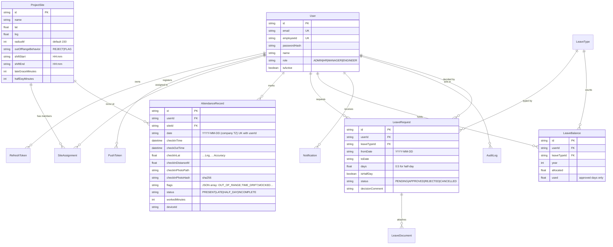

# RELAY Attendance — Architecture

Geo-tagged attendance & leave management for construction site engineers.
Live-photo + GPS proof of presence, geofencing, anti-fraud, leave workflow, manager/HR dashboards, reports.

## 1. System components

| Component | Tech | Location |
|---|---|---|
| Backend API | Node.js + Express + TypeScript, Prisma ORM, JWT, zod, multer, helmet | `backend/` |
| Database | SQLite for local dev/test (zero-install); PostgreSQL via Docker Compose for deployment | `backend/prisma/schema.prisma`, `docker-compose.yml` |
| Mobile app (Site Engineer) | Expo (React Native, TypeScript), expo-camera, expo-location, expo-secure-store, expo-notifications, expo-document-picker | `mobile/` |
| Web dashboard (Manager / HR / Admin) | React + Vite + TypeScript + Tailwind CSS + recharts + react-leaflet | `web/` |

## 2. Folder layout

```
relay-attendance/
├── ARCHITECTURE.md / DECISIONS.md / PROGRESS.md / README.md / TESTING.md
├── docker-compose.yml
├── backend/
│   ├── Dockerfile
│   ├── prisma/
│   │   ├── schema.prisma          # single source of truth for the data model
│   │   ├── migrations/            # committed SQL migrations (SQLite dialect)
│   │   └── seed.ts                # demo dataset: 1 admin, 1 HR, 2 managers, 5 engineers, 3 sites…
│   ├── scripts/
│   │   ├── setup-env.js           # creates .env with random secrets (no hardcoded secrets)
│   │   └── use-provider.js        # switches Prisma datasource sqlite ↔ postgresql (Docker path)
│   ├── src/
│   │   ├── index.ts               # bootstrap (listen)
│   │   ├── app.ts                 # express app factory (used by tests via supertest)
│   │   ├── config/env.ts          # zod-validated environment
│   │   ├── lib/                   # prisma client, errors, geo (Haversine), time/TZ,
│   │   │                          # storage service (local disk / S3-swap), sha256, signed URLs, audit
│   │   ├── middleware/            # auth (JWT + RBAC), error handler, multer upload, rate limit, validate
│   │   ├── schemas/               # zod request schemas
│   │   ├── services/              # auth, attendance, leave, reports, notifications, push
│   │   └── routes/                # auth, attendance, leave, sites, users, notifications, reports, uploads
│   ├── tests/                     # Jest + supertest (globalSetup migrates a dedicated test.db)
│   └── storage/                   # uploaded photos/documents (dev; git-ignored)
├── mobile/                        # Expo app (see mobile/README.md)
└── web/                           # Vite dashboard (see web/README.md)
```

## 3. Data model (ER diagram)



Full field-level definitions live in `backend/prisma/schema.prisma` (single source of truth), including `AuditLog`, `Notification`, `LeaveDocument`, `RefreshToken`, `PushToken`.

Notable constraints & indexes:
- `AttendanceRecord @@unique([userId, date])` — one record per engineer per day (hard duplicate block at DB level).
- `LeaveBalance @@unique([userId, leaveTypeId, year])`.
- Indexes on `AttendanceRecord(siteId, date)`, `LeaveRequest(userId, status)`, `Notification(userId, readAt)`, `AuditLog(createdAt)`.
- SQLite has no native enums → roles/statuses/flags are `String` columns constrained by zod at the API edge and TS union types in code (documented in DECISIONS.md).

## 4. API surface (v1, base path `/api`)

All JSON errors use one envelope: `{"error": {"code": "...", "message": "...", "details": …}}`.
Auth column: A=any authenticated, E=ENGINEER, M=MANAGER, H=HR, D=ADMIN; scopes applied inside services.

| Method & path | Roles | Purpose |
|---|---|---|
| POST `/api/auth/login` | public | email/employeeId + password → access + refresh tokens |
| POST `/api/auth/google` | public | Google Sign-In: verify ID token → RELAY tokens (linked active users only) |
| POST `/api/auth/refresh` | public | rotate refresh token → new pair |
| POST `/api/auth/logout` | A | revoke refresh token |
| GET `/api/auth/me` | A | current profile |
| POST `/api/attendance/check-in` | E | multipart: `photo`+`lat`+`lng`+`accuracy`+`clientTimestamp`+`deviceId`+`mocked`+`captureSource`+`siteId?` |
| POST `/api/attendance/check-out` | E | same shape as check-in |
| GET `/api/attendance/me?from&to&page&pageSize` | E | own history |
| GET `/api/attendance/me/summary?month=YYYY-MM` | E | monthly summary + per-day rows |
| GET `/api/attendance/team?date&siteId?` | M,H,D | today's board: roster + record + photos + location (M scoped to managed sites) |
| GET `/api/attendance/:id` | E(owner)/M/H/D | record detail |
| GET `/api/attendance/:id/photo/:side` (`in`\|`out`) | E(owner)/M/H/D | streams photo (auth header **or** signed query) |
| POST `/api/uploads/signed-url` `{path}` | A | HMAC-signed, expiring URL for a photo/document path |
| POST `/api/leave/requests` | E | multipart: `leaveTypeId,fromDate,toDate,isHalfDay?,halfDayPeriod?,reason`+`document?` |
| GET `/api/leave/requests/me?status=` | E | own requests |
| POST `/api/leave/requests/:id/cancel` | E(owner, PENDING) | cancel |
| GET `/api/leave/requests?status&userId&scope` | M,H,D | approval queue (M scoped) |
| POST `/api/leave/requests/:id/approve` `{comment?}` | M,H,D | approve (deducts balance) |
| POST `/api/leave/requests/:id/reject` `{comment}` | M,H,D | reject (comment required) |
| GET `/api/leave/balances/me?year=` | E | balances with `available` |
| GET `/api/leave/balances?userId&year=` | H,D | balances for any user |
| POST `/api/leave/balances/adjust` | H,D | set allocation (audited) |
| GET `/api/leave/types` · POST/PATCH `/api/leave/types[/:id]` | A / D | leave type config |
| GET `/api/leave/documents/:id` | E(owner)/M/H/D | stream supporting document |
| GET `/api/sites` | A | sites (admins get full config) |
| POST/PATCH `/api/sites[/:id]` | D | site + geofence config |
| GET `/api/sites/:id/assignments` | D,H,M | assignment list |
| POST `/api/sites/:id/assignments` `{userId}` · DELETE `/api/sites/:id/assignments/:aid` | D | assign / deactivate |
| GET `/api/users?role&q` | D,H (M→scoped engineers) | list |
| POST `/api/users` · PATCH `/api/users/:id` | D,H | create/update (password reset, deactivate) |
| GET `/api/notifications/me?unreadOnly=` · POST `/:id/read` · POST `/read-all` | A | in-app notifications |
| POST `/api/notifications/push-token` `{token,platform}` | A | register Expo push token |
| GET `/api/reports/attendance?month&siteId&format=json\|csv\|pdf` | M,H,D | monthly attendance report |
| GET `/api/reports/leave?from&to&format=` | M,H,D | leave report |
| GET `/api/reports/payroll?month&format=` | H,D | payroll-ready summary |
| GET `/api/health` | public | liveness |

## 5. Auth flow

1. `POST /auth/login` — identifier = email **or** employeeId; bcrypt compare; issues **access JWT** (15 min, HS256, payload `{sub, role, type:"access"}`) and **refresh token** (random 64-hex, stored **hashed** in `RefreshToken`, 7 d TTL).
2. Refresh rotates: presented token is verified against its hash, must be unrevoked & unexpired; old token revoked, new pair issued (reuse of a revoked token revokes the whole chain → `AUTH_REFRESH_REUSE` audit entry).
3. `POST /auth/logout` revokes the presented refresh token.
4. Middleware `authenticate` verifies the access JWT, loads the user (must be `isActive`), attaches `req.user`; `requireRole(...)` enforces RBAC per route; data-scoping (manager sees only team sites) runs in services.

## 6. Geofence & anti-fraud logic (server-authoritative)

- **Server clock wins.** Client sends `clientTimestamp`; every stored `checkInTime/checkOutTime` is the server's `new Date()`. `|client − server| > 600 s` → record flagged `TIME_DRIFT` (and `clientDriftSeconds` stored).
- **Haversine distance** between the engineer's `(lat,lng)` and the site's coordinates, computed server-side, stored as `checkInDistanceM`.
- **Geofence**: if `distance > site.radiusM`:
  - `site.outOfRangeBehavior = REJECT` → `422 GEO_OUT_OF_RANGE`, message includes the actual distance ("You are 213 m from site — allowed radius is 150 m"). No record written.
  - `FLAG` → record saved with flag `OUT_OF_RANGE` (manager sees it flagged).
- **Live photo only**: `captureSource` must be `camera` (the app's in-camera capture flow; there is no gallery path for attendance) and a `photo` file is mandatory. SHA-256 of exact bytes stored as `checkInPhotoHash`.
- **GPS quality**: `accuracy > 50 m` → `422 LOW_GPS_ACCURACY`. `mocked = true` (expo-location `LocationObject.mocked`) → `422 MOCKED_LOCATION`.
- **Duplicates**: `@@unique([userId, date])` + pre-check → `409 ALREADY_CHECKED_IN`. Check-out without check-in → `409 CHECK_IN_REQUIRED`. Double check-out → `409 ALREADY_CHECKED_OUT`.
- **Device & audit**: `deviceId` required and stored; every check-in/out, login, leave decision and admin action is appended to `AuditLog` with actor, IP, and metadata.
- **Statuses**: `LATE` when check-in > `site.shiftStart + lateGraceMinutes`; `HALF_DAY` when worked < `site.halfDayMinutes` on checkout; `INCOMPLETE` when no check-out; user-facing summary merges approved leave days as `ON_LEAVE` (never `ABSENT`).

## 7. Leave engine rules

- **Days**: inclusive `fromDate..toDate`; `isHalfDay` allowed only for a single date → 0.5 d.
- **Validation**: no overlap with own PENDING/APPROVED requests; `fromDate` not before today − `leaveType.minNoticeDays` (past-date abuse guard); `maxConsecutiveDays` cap; document required when `requiresDocument`.
- **Balance model (availability)**: `available = allocated − used(approved) − pending(requested)`. Submit reserves (reduces availability) without touching `used`. Approve moves the reservation into `used`. Reject/cancel releases it — this is the "restores balance" semantics implemented on reservations (see DECISIONS.md #7).
- **Workflow**: PENDING → APPROVED / REJECTED (comment mandatory) / CANCELLED (owner, while pending). Notifications (in-app row + Expo push if token registered) fire to the engineer and to managers of the engineer's sites.
- Approved leave days surface in attendance summaries as `ON_LEAVE` (half-day leave + worked half-day → `HALF_DAY`).

## 8. Timezone policy

All business dates (`AttendanceRecord.date`, leave dates) are computed in the **company timezone** `COMPANY_TZ` (default `Asia/Kolkata`) from the server clock — never from client-provided values. Summary "today"/"month" boundaries follow the same TZ.

## 9. Testing strategy

- Jest + ts-jest + supertest against a dedicated `prisma/test.db` (globalSetup runs `prisma migrate deploy`). `--runInBand`, each spec resets tables and seeds fixtures.
- Cover: auth/RBAC, geofence reject/flag, duplicate check-in, check-out w/o check-in, low accuracy, mocked GPS, drift flag, leave overlap/balance/approve/reject/cancel, report CSV/PDF outputs.
- Mobile/web are verified by type-check + production build (+ live smoke against the seeded backend) — see PROGRESS.md.
